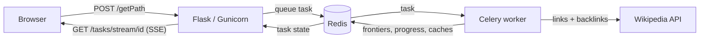

<!-- markdownlint-disable MD033 -->

<p align="center">
  <a href="https://dscvit.com">
    
  </a>
</p>

<p align="center">
  
</p>

## Iris Wikipedia Pathfinder

[](https://github.com/mdhishaamakhtar/iris/actions/workflows/ci.yml)

Iris finds a path between any two Wikipedia pages by traversing their links.

You give it two page titles — say, "Banana" and "Shah Rukh Khan" — and it walks Wikipedia's link graph using BFS until it finds the connection. Results are visualized as an interactive graph you can drag around.

It uses **bidirectional BFS** (default) which searches simultaneously from both pages toward each other using Wikipedia backlinks, meeting in the middle for faster results. You can also use standard forward-only BFS if preferred. Redis stores the search state instead of holding everything in memory, which keeps it from blowing up on deep searches.

## What It Does

- Find Wikipedia paths via **bidirectional BFS** (default) or standard forward-only BFS
- **Watch both frontiers grow** — each side shows the pages it is reading and how deep it has gone, streamed over Server-Sent Events
- **Every step explained** — the route quotes the sentence in each article that links to the next one
- **Shareable routes** — `/?from=Banana&to=Shah%20Rukh%20Khan` opens (or runs) that search, and unfurls in Slack, Discord or a social feed as an image of the route
- **Title suggestions** as you type, with disambiguation pages flagged before they fail
- Interactive D3.js graph of the path, and a ruled route list

## How It Works



The web process never searches. It queues a Celery task and streams the task's
state back to the browser. The worker runs one breadth-first search over one
or two *frontiers*: forward from the start page through its links, and backward
from the end page through its backlinks, always expanding whichever side is
smaller. When a page turns up in both, the path is read back out of the parent
pointers. Every piece of search state — queues, visited sets, parent pointers —
lives in Redis, namespaced per search and deleted when it ends.

Link lists are cached in Redis. Hub articles (500+ links: countries, years,
broad topics) are cached for a week rather than a day, because nearly every
search passes through them.

The route found is the first one, not a proven shortest: Wikipedia caps how
many links one request returns, and Iris follows at most three continuations
per article.

## Performance

Search time is Wikipedia's request latency times the number of requests in
flight, not computation. Measured with `scripts/benchmark.py` on 24 October
2026: bidirectional search, production settings, a cold cache, one run each,
from a developer laptop.

| Route | Time | Wikipedia requests | Pages explored | Path |
| --- | ---: | ---: | ---: | --- |
| Pizza → Byzantine Empire | 0.97 s | 2 | 1 | 2 pages |
| Mount Everest → Jazz | 2.79 s | 6 | 2 | 3 pages |
| Kangaroo → Fourier transform | 5.44 s | 33 | 22 | 4 pages |
| Pikachu → Quantum chromodynamics | 5.93 s | 37 | 22 | 4 pages |
| Taylor Swift → Photosynthesis | 7.37 s | 40 | 22 | 4 pages |
| Barack Obama → Mathematics | 8.70 s | 54 | 22 | 4 pages |

A repeated search is answered from the path cache in milliseconds. Run
`uv run python scripts/benchmark.py` (needs local Redis and network) to
measure your own; `--compare` prints before/after.

## API

| Method | Path | Purpose |
| --- | --- | --- |
| `POST` | `/getPath` | Start a search: `{start, end, algorithm?}` → `202` with `task_id` |
| `GET` | `/tasks/stream/<id>` | Progress and result as Server-Sent Events |
| `GET` | `/tasks/status/<id>` | The same status body, polled |
| `DELETE` | `/tasks/<id>` | Stop a search |
| `GET` | `/api/suggest?q=` | Title suggestions |
| `GET` | `/api/context?from=&to=` | The sentence in one article that links to the next |
| `GET` | `/api/og.png?from=&to=` | Share image for a route |
| `GET` | `/health` | Redis connectivity |

Full schemas are in Swagger at `/api/docs`. The API is public and
unauthenticated, so it is rate-limited per client: 10 searches a minute, 120
requests a minute to the lighter endpoints (`429` with `Retry-After` beyond).

## Tech Stack

[](https://python.org)
[](https://flask.palletsprojects.com)
[](https://docs.celeryproject.org/)
[](https://redis.io)
[](https://gunicorn.org/)
[](https://d3js.org/)
[](https://github.com/astral-sh/uv)
[](https://github.com/astral-sh/ruff)
[](https://github.com/astral-sh/ty)
[](./LICENSE)

## Quick Start

```bash
git clone https://github.com/mdhishaamakhtar/iris
cd iris

uv sync

./dev.sh
```

Then open [http://localhost:9020](http://localhost:9020).

Swagger docs at [http://localhost:9020/api/docs](http://localhost:9020/api/docs).

## Scripts

| Script | When to use |
|--------|-------------|
| `dev.sh` | Local development — starts Redis (if needed), Flask, and Celery in one terminal |
| `entrypoint.sh` | The Docker image's `CMD` — runs Gunicorn, or Celery when `SERVICE_TYPE=worker` |

## Dev

```bash
uv run pytest                                        # run tests
uv run pytest --cov=app --cov-report=term-missing    # run tests with coverage
uv run pytest --cov=app --cov-report=html            # generate HTML coverage report (open htmlcov/index.html)
uv run ruff format .                                 # format
uv run ruff check .                                  # lint
uv run ty check                                      # type check
uvx pre-commit install                               # run format, lint and types on every commit
```

CI runs the same checks on every push and pull request, requires 95% test
coverage, and builds the Docker image. Tests run against `fakeredis` with only
Wikipedia stubbed, so the search, the Redis store and the HTTP API run for real.

## Contributors

- **Md Hishaam Akhtar** — [GitHub](https://github.com/mdhishaamakhtar) · [LinkedIn](https://www.linkedin.com/in/md-hishaam-akhtar-812a3019a/)
- **Sharanya Mukherjee** — [GitHub](https://github.com/sharanya02) · [LinkedIn](https://www.linkedin.com/in/sharanya-mukherjee-73a2061a0/)

<p align="center">
  Made with :heart: by <a href="https://dscvit.com">DSC VIT</a>
</p>
